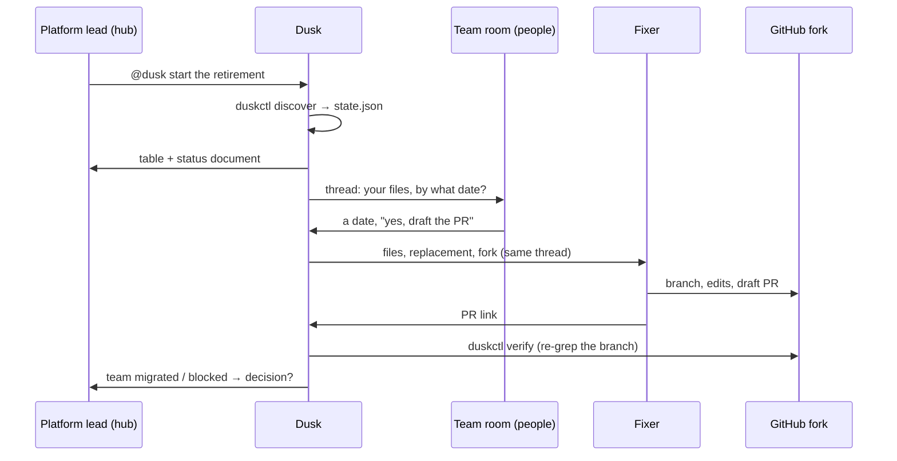
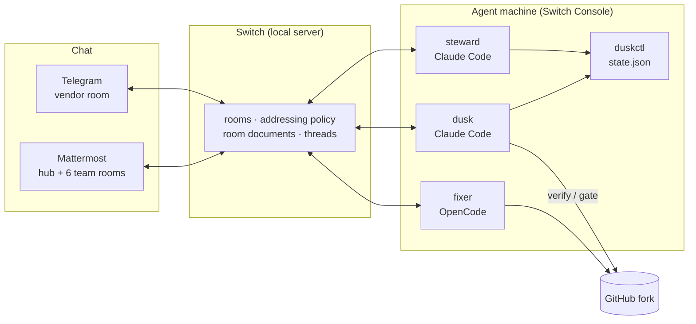

# Dusk

An agent that runs cross-team change campaigns inside the chat rooms your teams already use, built on Switch.

## What does this do?

Some changes need many teams to touch their own code: retiring an internal API, a library
upgrade with breaking changes, removing a feature flag, renaming a service, fixing a
security finding across repositories. One team wants the change; six others have to do
the work. Today that is a spreadsheet, weeks of "who still uses this?" messages, and a
job nobody owns, so it drags.

Dusk owns that job. Given a repo and a pattern, it finds every caller, works out which team
owns each file from the repo's CODEOWNERS, opens a thread in each team's room asking for a
date, drafts the fix as a pull request when a team wants one, records dates and blockers
in one status document, and brings only decisions to the person in charge. It calls the
change finished when a fresh search of the code finds nothing left, not when someone says so.

The demo retires Grafana's legacy in-process event bus, `pkg/bus`, across the seven teams
that still call it. From a fresh clone of grafana/grafana:

> **20 call sites · 20 files · 7 teams · found in 0.3 s** (27 s including the clone),
> owners taken from `.github/CODEOWNERS`. See
> [`examples/grafana-pkg-bus/discovery.md`](examples/grafana-pkg-bus/discovery.md).

## Why did we build this?

Platform teams at every company do this by hand. The hard part is not the code change;
it is the coordination: finding owners, asking, waiting, chasing, escalating, and knowing
when it is really done. That coordination happens in team chat, so the agent should live
there too, in each team's own room, rather than in a dashboard nobody opens. Switch gives
an agent exactly that: rooms, people, other agents, and the rules about who may ask what.

## How it works

1. The platform lead types `@dusk start the retirement of pkg/bus` in the hub room.
2. Dusk clones the repo, runs `git grep` for the pattern, maps each file to its owning
   team with GitHub's CODEOWNERS rules (last matching pattern wins), posts a table in the
   hub and creates a status document there.
3. For each team, Dusk goes to that team's room, posts a thread with the team's files and
   one question ("by what date can you migrate?"), then returns to the hub.
4. A team answers with a date. Dusk records it. If the team wants help, Dusk hands the
   team's files to Fixer, an agent from a second vendor, in the same thread. Fixer edits
   only those files on a branch of the fork and opens a draft pull request.
5. Dusk re-runs the grep on Fixer's branch. Zero callers in the team's files means the
   team is done; anything else is not. The team reviews and merges; no agent merges.
6. A team says it cannot make the date. Dusk records the blocker, proposes a new date and
   asks the lead in the hub. The lead's answer is recorded as a decision.
7. Steward reads the ledger. After three pull requests approved without changes it
   proposes widening who may task Fixer (from "only Dusk" to "anyone in the rooms"); after
   a rejected one it proposes narrowing it back. It changes nothing until the lead says yes.
8. When every team is done and a fresh grep of the whole repo finds zero callers, Dusk
   opens the removal pull request and asks the lead to approve it.



## Architecture

There is no server, database or UI of our own. Switch provides the rooms, the chat
bridges and the runtime that starts the agents; the agents run on one machine; the
deterministic parts are a small Python CLI that reads and writes one JSON file.



Three agents:

| Agent | Provider | Addressing at start | Job |
|---|---|---|---|
| `dusk` | Claude Code | anyone | discovery, outreach per team, the status document, blockers to the lead, verification, the removal gate |
| `fixer` | OpenCode (a second vendor) | owner-agents: only Dusk can task it | draft one team's migration PR on the fork; never merge |
| `steward` | Claude Code | owner | propose widening or narrowing Fixer's reach from the ledger; act only on the lead's yes |

Their instructions are in [`agents/`](agents/). They contain the procedure only; every
fact about a particular campaign (repo, endpoint, pattern, replacement, dates, the team's
files) is written into each room's instructions by the template, so the same agents run
any campaign.

## How Switch is used, and why it would stop working without it

"Addressing" below is Switch's rule for who may talk to an agent: its owner only, the
owner and their other agents, or anyone in its rooms.

| Switch mechanism | What it carries here |
|---|---|
| Rooms, one per team plus a hub, in a room group with links | The campaign's shape. Each team is asked where it already works; decisions land in the hub. |
| Room instructions as bindings | Repo, endpoint, grep pattern, replacement, target date, the team's handle and files. |
| Room document | The status document in the hub, rendered from `state.json` by Dusk, the only agent allowed to edit it. |
| Addressing changed at runtime (`update_agent_detail`) | Fixer starts at owner-agents. Steward widens it to anyone after three approved PRs and narrows it after a rejection, on the lead's word. Reach is earned, and Switch enforces it. |
| Two vendors' agents in one room | Dusk (Claude Code) hands work to Fixer (OpenCode) with a targeted message in the team's thread; Fixer reports back the same way. |
| Several chat apps on one server | Six teams on the bundled Mattermost, an outside vendor on Telegram; same agent, same ledger; tables where they render, one line per item where they do not. |
| Threads | One thread per team; every status change for that team is a reply in it. |
| Template (version 2) | Three agents, the group, the hub, the team rooms, links and the kickoff, created in one paste; generated from the real discovery so the rooms match the real teams. |
| Cross-room reads and hops | Dusk reads other rooms with `read_context(room_id)` without leaving the hub and makes round trips with `connect_to_room`. |

Without Switch there is no room per team, no bindings per room, no addressing to earn, no
hand-off between vendors and no bridge to Telegram. What remains is a script that emails
people.

## Example

The lead wants `pkg/bus` gone from grafana/grafana by 2027-03-31. They paste the template,
pick Mattermost, and click Create. Two minutes later the hub shows the table: seven teams,
twenty files. Within another two minutes each team has a thread in its room.

The Alerting engineer replies "end of January works, and yes, draft the PR". Dusk records
2027-01-31, hands Alerting's four files to Fixer, and goes back to the hub. Fixer branches
`dusk/pkg-bus/alerting` on the fork, changes the four files, runs `gofmt` and the grep,
tries `go build` within a ten-minute budget, and opens draft PR #1 with a body that says
exactly what was and was not run. Dusk re-greps the branch: zero callers. Alerting moves to
"migrated". The engineer approves the PR as is; Dusk notes `pr:approved` in the ledger.

Search & Storage replies "not before March, release freeze". Dusk records the blocker,
proposes 2027-03-31, and asks the lead in the hub. The lead types "accept 2027-03-31 for
search-storage". The table shows the new date and the decision is in the history.

After three approvals, Steward posts: Fixer's reach can be widened. The lead says yes;
Fixer's addressing becomes anyone, and teams can ask it directly. When the last team is
done, `duskctl gate` runs a fresh grep of the whole repo, finds nothing, and Dusk opens the
removal PR for the lead to approve.

## Getting started

Prerequisites on the machine that will run the agents (tested on Windows 11; macOS and
Linux should work the same):

- [Switch Console](https://github.com/sandbox-quantum/switch/releases/latest), set up
  "On this computer", with Docker Desktop running for the bundled Mattermost.
- [Claude Code](https://claude.com/claude-code) installed and signed in.
- [OpenCode](https://opencode.ai) installed and signed in: `npm i -g opencode-ai`, then
  `opencode auth login`. (Any two providers Switch supports will do; set `fixer_provider`
  in `teams.yaml`.)
- [GitHub CLI](https://cli.github.com) logged in to the account that owns the fork:
  `gh auth login --insecure-storage` (see Limitations for why), then `gh auth setup-git`.
- A fork of the target repository. Every PR goes to the fork, never upstream.
- Python 3.11+, git. Go only if you want Fixer to compile Go packages.

```bash
git clone https://github.com/Manvith-Shetty/Dusk dusk
cd dusk
pip install -e tools            # installs the duskctl command
cd tools && python -m pytest -q && cd ..   # 24 tests
```

Generate the template for the example campaign and run it:

```bash
python scripts/build_template.py examples/grafana-pkg-bus
# → dist/dusk.template.yaml
```

In Switch Console: Templates → Save → paste `dist/dusk.template.yaml` → Use → messaging
app: Mattermost → Create. Switch creates the three agents, the room group, the hub and the
team rooms, and posts the kickoff that starts Dusk. Open Mattermost (Console → Home →
Mattermost → Sign-in details) and watch the hub.

Two flags are useful while developing: `--local-checkout .` runs Dusk and Steward straight
from your checkout instead of cloning this repo; `--skip-join` leaves Telegram rooms to be
joined by hand with `!invite-agent @dusk`.

For your own campaign:

```bash
mkdir examples/my-campaign && cd examples/my-campaign
duskctl discover --repo https://github.com/org/repo --endpoint "pkg/old" \
  --pattern 'github.com/org/repo/pkg/old"' --include "pkg/**/*.go" \
  --exclude "**/*_test.go" --declaring "pkg/old/**"
# writes discovery.json and discovery.md; then write teams.yaml (see Configuration)
cd ../.. && python scripts/build_template.py examples/my-campaign
```

## Configuration

`examples/<campaign>/teams.yaml`:

| Key | Meaning |
|---|---|
| `endpoint` | Human name of what is being retired or changed; appears in room names. |
| `repo` | The upstream repository to search. |
| `fork` | Where every PR is opened. Never the upstream. |
| `pattern` | Extended regex passed to `git grep -E`. |
| `include`, `exclude` | Path globs (`**` supported). A glob with no slash matches anywhere. |
| `declaring` | Globs for the files that define the endpoint; matches there are not counted as callers and are what the removal PR deletes. |
| `replacement` | What callers should use instead; goes into every room's bindings and Fixer's brief. |
| `target_date` | The platform team's wish, `YYYY-MM-DD`. |
| `fixer_provider` | `opencode`, `codex` or `claude`. Written literally into the template. |
| `teams.<handle>` | Per CODEOWNERS team: `short`, `display`, `chat_app` (Mattermost by default; `Telegram` means an existing group, not created), `room_name`. |

The agents need no configuration of their own: Switch Console writes each agent's
credentials into its working directory. Secrets never go into this repository.

## Project structure

```
agents/dusk|fixer|steward/AGENT.md   the agents' instructions, inlined into the template
tools/duskctl/
  codeowners.py                      GitHub CODEOWNERS parsing and matching
  discover.py                        clone → git grep → team mapping → discovery.json/.md
  state.py                           state.json: teams, transitions, history, decisions
  render.py                          table (Mattermost), lines (Telegram/Slack), document
  cli.py                             the duskctl command
tools/tests/                         24 tests, incl. an end-to-end discovery on a temp repo
scripts/build_template.py            discovery + teams.yaml + agents → version-2 template
examples/grafana-pkg-bus/            the real discovery and the team → room mapping
dist/                                generated templates
docs/demo-script.md                  the demo, scene by scene, with setup
docs/submission.md                   hackathon form answers
```

`duskctl` subcommands: `discover`, `init`, `status`, `teams`, `brief`, `ask`, `date`,
`block`, `pr`, `note`, `verify`, `nudge`, `decide`, `gate`, `removal-pr`, `steward`.
`duskctl --help` lists them. `state.json` is the single source of truth and the agents
only change it through these commands; a team is only ever `done` when `verify` finds
zero callers.

## Demo

[`docs/demo-script.md`](docs/demo-script.md) walks through the recorded demo scene by
scene, including how to reset the rooms and play the team humans from a second Mattermost
user. Video: _link_.

## Design decisions

- **Judgement in agents, exactness in a tool.** Discovery, the state machine, rendering
  and the gate are code with tests. The agents decide what to say and when to escalate.
  A team cannot be marked done by anyone's word, including Dusk's.
- **Bindings in rooms, procedure in agents.** The template writes campaign facts into room
  instructions. The agent prompts never name a repo or a team, so one set of agents runs
  every campaign. This follows the "procedure vs bindings" pattern from Switch's own
  design notes.
- **Dusk rests in the hub and makes round trips.** Its sessions share no memory (Switch
  starts one per room), so all state lives in `state.json` on disk and in the hub
  document rendered from it.
- **Earned reach on Fixer, not on Dusk.** Team members must be able to address Dusk from
  the start or their replies would not wake it. Fixer is the agent whose reach can be
  earned: it starts reachable only by Dusk, and teams gain direct access after its work
  has been approved three times.
- **Draft PRs only, on a fork.** Fixer never merges, never touches upstream, and leaves
  `TODO(dusk)` markers where a design decision belongs to the team. Its PR body says what
  it ran and what it did not.
- **Generated template.** The room list comes from the real discovery, so judges get the
  real teams, and a new campaign is `discover` plus `build_template`.

## Limitations

- Switch's addressing is per agent, not per room, so widening Fixer applies to all its
  rooms. The agents say so when it happens.
- People in bridged chats cannot open room documents, so Dusk also posts the table in chat.
- Switch has no message edit and no scheduler: status changes are thread replies, and
  nudges happen only when Dusk is woken (at most once a day per team).
- Telegram renders no tables and cannot create chats; the vendor's group is created in
  Telegram and adopted, and Dusk is invited by hand.
- Fixer's build step is best-effort within about ten minutes; on a large Go repo without
  a warm module cache it reports "build not run" rather than hanging.
- Windows, Switch Console 0.40.1 (early access): the template form cannot resolve a
  provider parameter, so providers are written literally; Console may time out while the
  server is still creating rooms (the run completes anyway); CLIs installed after Console
  started are not on the agents' PATH until Console is restarted; and processes started by
  the agent controller cannot read the Windows keyring, so `gh` must store its token with
  `--insecure-storage`.
- The people in the demo are played by the author from two accounts. The replacement for
  `pkg/bus` is a plausible direction, not Grafana's decision.

## Future improvements

- A room-level view of pending questions per team, once Switch exposes one.
- Nudges on a schedule when Switch gains one (issue #771); today they ride on Dusk's turns.
- `duskctl discover` for languages where imports are not a grep: a tree-sitter pass.
- Per-room addressing for Fixer when Switch supports it, so trust can be earned per team.

## Hackathon

Built for the WeMakeDevs × Switch "Flip the Switch" hackathon (Track 01, Business
Workflow), November 2026. The whole Switch setup and the workflow were built during the
event; the agents' instructions and most of the prompts that built the code were dictated
with Wispr Flow. What makes it interesting: a cross-team coordination job that normally has
no owner gets one, the agent earns its reach instead of being granted it, and "done" is
decided by a grep rather than a message.

License: MIT.
